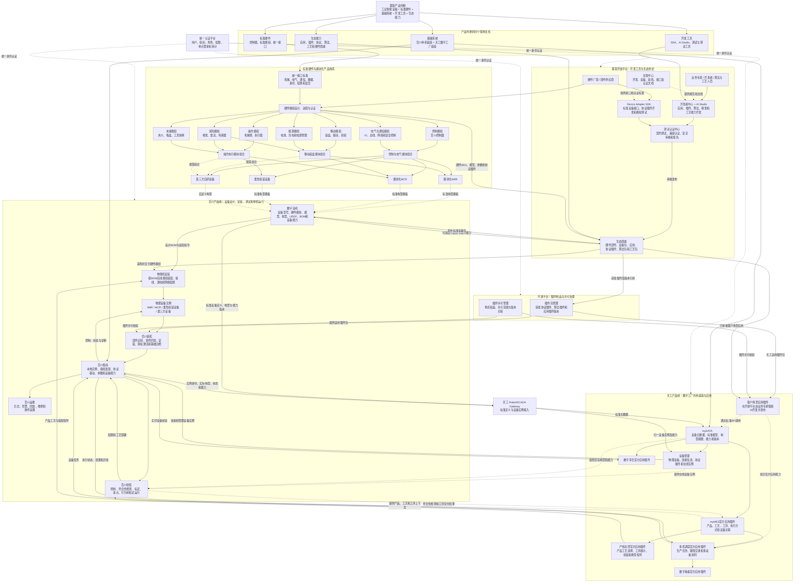
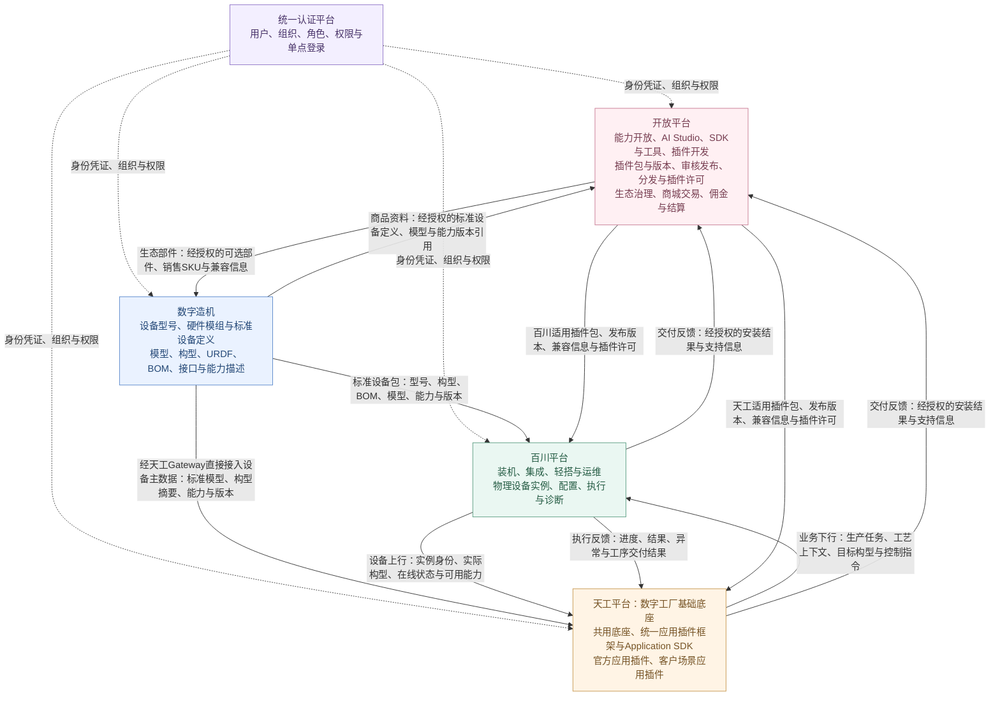
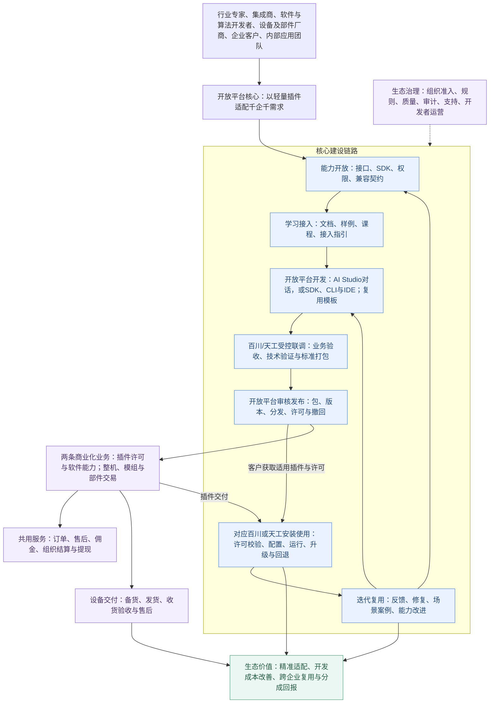
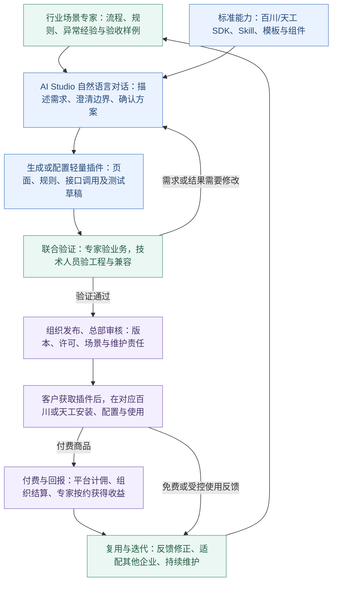
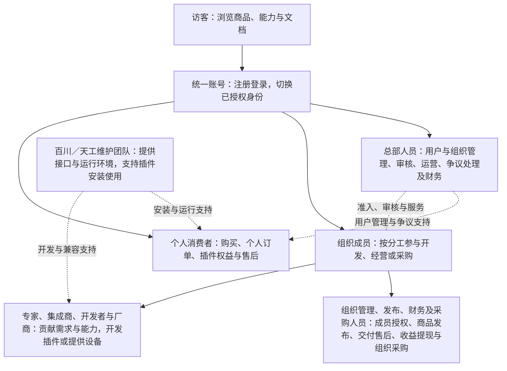
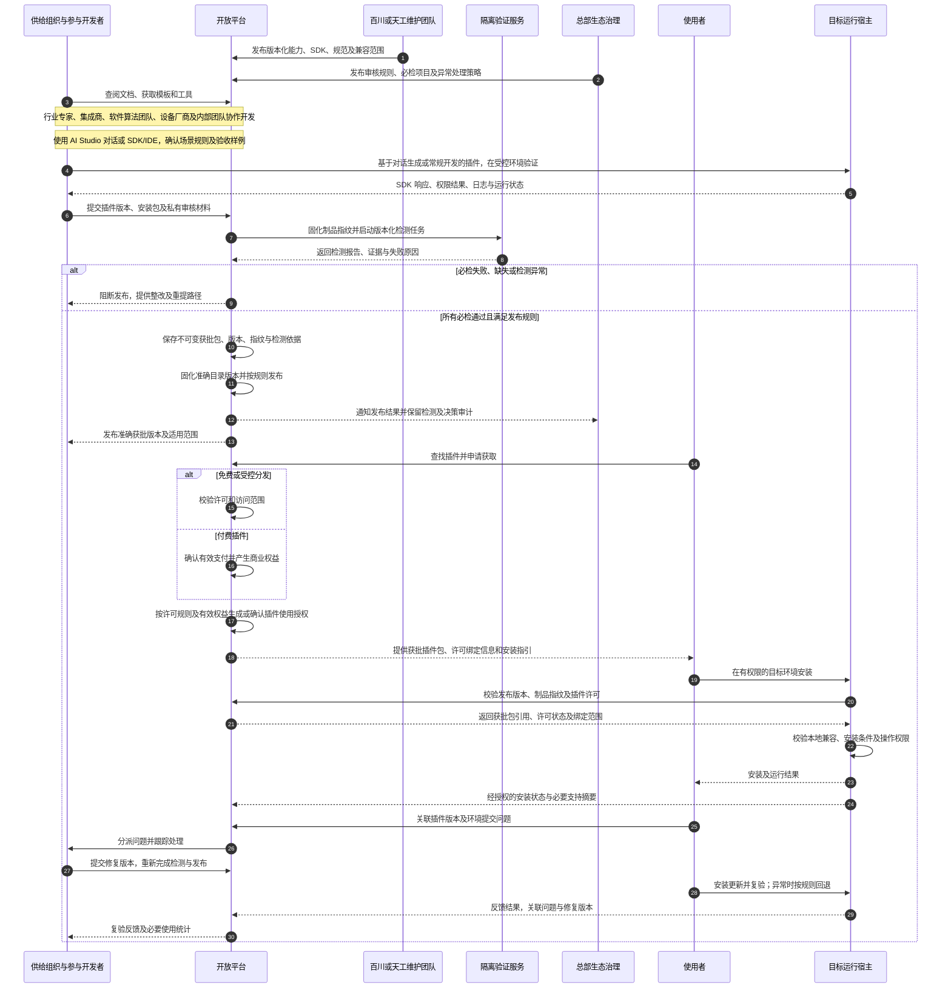
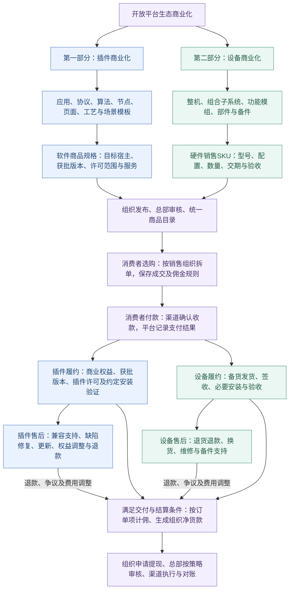
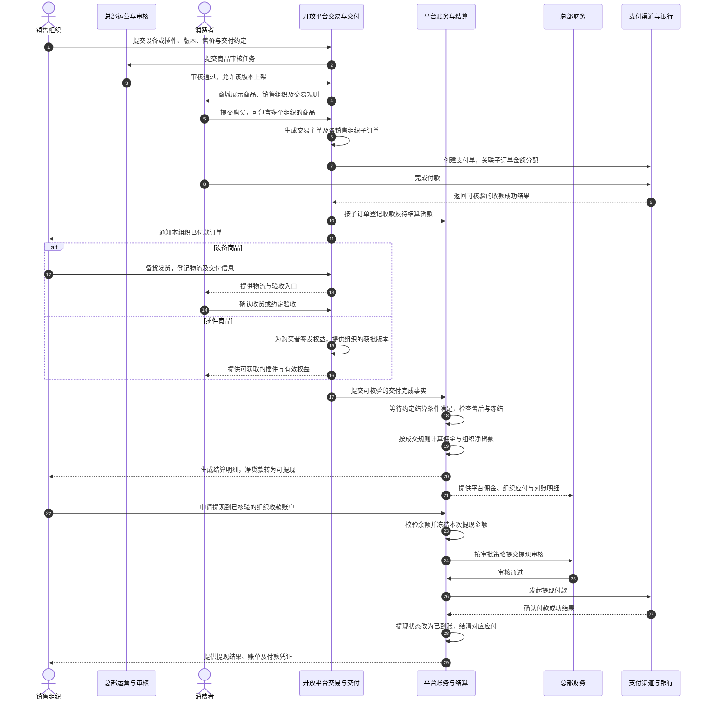
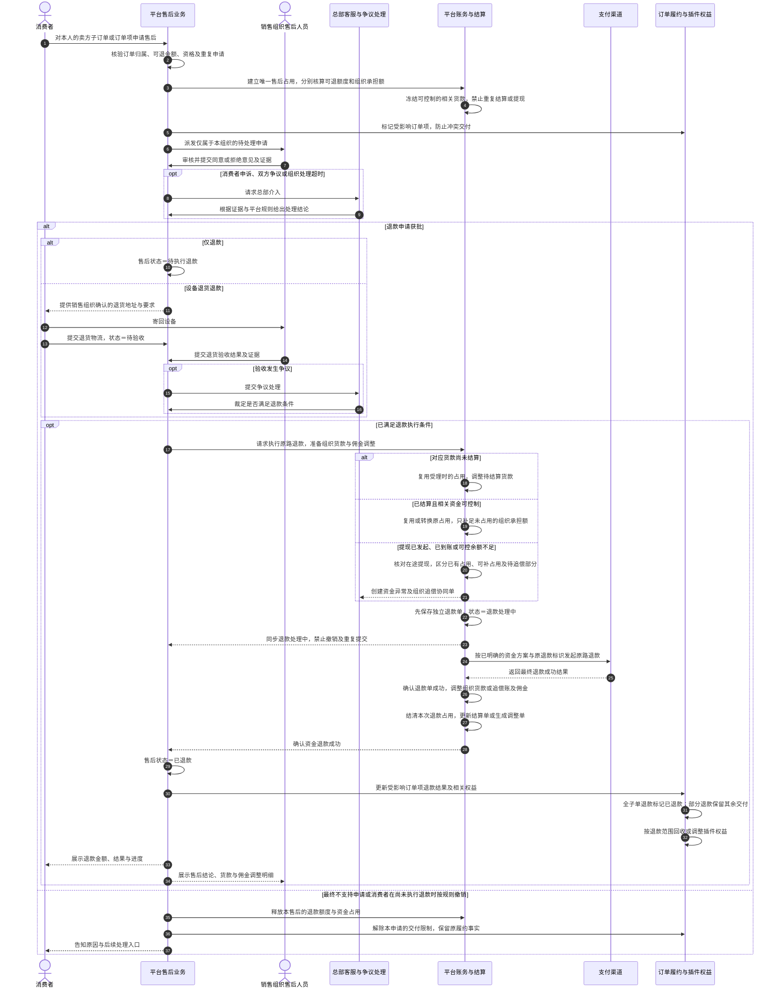
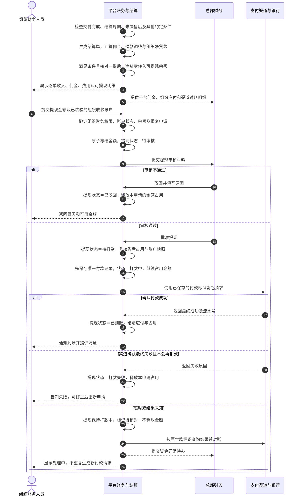

# 墨影开放平台产品立项报告（二）

| 项目编号 | MR106 | 申报日期 | 2026年9月6日 |
| --- | --- | --- | --- |
| 项目名称 | MR106-墨影开放平台 | 产品版本 | V1.0 |
| 产品负责人 | 邓建平 | 项目负责人 | 待任命 |
| 所属部门 | 产品部 | 项目周期 | 2026年10月1日—12月31日，共3个月 |
| 产品形态 | 纯 Web：开发者门户、组织控制台、消费者中心、总部控制台 | 部署方向 | 国内云、公司服务器或私有化部署 |
| 文档版本 | V1.1（基于“二”版的竞品与格式修订稿） | 项目性质 | 软件研发项目 |
| 修订日期 | 2026年9月8日 | 编制状态 | 待评审，预算与资源待核定 |

**目录**

*   [1 战略背景与目标](#1-%E6%88%98%E7%95%A5%E8%83%8C%E6%99%AF%E4%B8%8E%E7%9B%AE%E6%A0%87)
    
*   [2 产品体系总览](#2-%E4%BA%A7%E5%93%81%E4%BD%93%E7%B3%BB%E6%80%BB%E8%A7%88)
    
*   [3 对标竞品与竞争分析](#3-%E5%AF%B9%E6%A0%87%E7%AB%9E%E5%93%81%E4%B8%8E%E7%AB%9E%E4%BA%89%E5%88%86%E6%9E%90)
    
*   [4 立项背景与项目价值](#4-%E7%AB%8B%E9%A1%B9%E8%83%8C%E6%99%AF%E4%B8%8E%E9%A1%B9%E7%9B%AE%E4%BB%B7%E5%80%BC)
    
*   [5 技术现状、路线与关键指标](#5-%E6%8A%80%E6%9C%AF%E7%8E%B0%E7%8A%B6%E8%B7%AF%E7%BA%BF%E4%B8%8E%E5%85%B3%E9%94%AE%E6%8C%87%E6%A0%87)
    
*   [6 项目成本测算及收益分析](#6-%E9%A1%B9%E7%9B%AE%E6%88%90%E6%9C%AC%E6%B5%8B%E7%AE%97%E5%8F%8A%E6%94%B6%E7%9B%8A%E5%88%86%E6%9E%90)
    
*   [7 项目计划与里程碑](#7-%E9%A1%B9%E7%9B%AE%E8%AE%A1%E5%88%92%E4%B8%8E%E9%87%8C%E7%A8%8B%E7%A2%91)
    
*   [8 项目风险与应对措施](#8-%E9%A1%B9%E7%9B%AE%E9%A3%8E%E9%99%A9%E4%B8%8E%E5%BA%94%E5%AF%B9%E6%8E%AA%E6%96%BD)
    
*   [9 市场推广方案](#9-%E5%B8%82%E5%9C%BA%E6%8E%A8%E5%B9%BF%E6%96%B9%E6%A1%88)
    
*   [10 立项建议](#10-%E7%AB%8B%E9%A1%B9%E5%BB%BA%E8%AE%AE)
    
*   [11 编制依据与阅读说明](#11-%E7%BC%96%E5%88%B6%E4%BE%9D%E6%8D%AE%E4%B8%8E%E9%98%85%E8%AF%BB%E8%AF%B4%E6%98%8E)
    

## 1 战略背景与目标

### 1.1 行业背景

机器人、具身智能设备和工业自动化正在从少量、单一、固定场景，走向多品种、小批量、快速换型和持续迭代。客户需要的不再只是一台能够运行的机器，而是一套可以快速设计、组合、调试、交付、升级和复用的智能设备生产方式。

但当前行业仍主要采用“整机项目制”模式：每交付一种机器人或工业设备，厂商都要重新进行机械与电气设计、控制系统适配、底层软件开发、应用开发、现场集成和调试。设备厂商、系统集成商和最终客户因此反复面对以下问题：

*   **重复建设严重**：设备接入、控制、配置、调度、可视化和运维能力在不同项目中反复开发；
    
*   **软硬件高度耦合**：部件选型、控制器、驱动、算法和应用依赖具体项目，难以组合和替换；
    
*   **交付周期过长**：设备设计完成后，仍需重新采购部件、适配软件并进行大量现场调试；
    
*   **项目经验难以产品化**：一次性交付形成的能力无法沉淀为标准模块、插件、模板和工具；
    
*   **生态协作能力不足**：第三方部件供应商、算法开发者和集成商缺少统一的接入、开发、认证与交易平台；
    
*   **全生命周期断裂**：设备设计、采购、装机、调试、生产运行和运维追溯之间缺少统一的数据链路。
    

行业当前更关键的缺口，并非单一设备或单点软件能力，而是一套能够贯通设备数字设计、关键部件选型、控制执行、软件工具链与数字工厂运行的统一基础底座。

### 1.2 墨影的产品判断

墨影认为，工业智能设备应当像计算机和智能手机一样，由标准硬件、基础系统、开发工具和生态能力共同组成。设备生产者不需要从底层重新开发整机，而应能够基于标准控制器、模块化部件和软件工具链快速完成自己的设备，并通过统一接口和开放平台，面向自身行业及业务场景持续开发上层应用、工艺能力和插件。

基于这一判断，墨影不以单一整机为最终产品边界，而是建设面向具身智能设备和数字工厂的基础底座生产力平台：

*   **百川产品线**定位为智能设备的单机基础底座，覆盖设备设计、装机、软硬件集成、调试、运行和运维，使客户能够自主制造和交付MCR、AMR及其他工业智能设备；
    
*   **天工产品线**定位为数字工厂基础底座平台，向下连接设备、数据和控制能力，向上支撑MES、WMS及行业应用，提供多机调度、边缘数采、数字孪生、数字看板和应用扩展能力；
    
*   **开放平台**承担生态供给，连接开发者、部件供应商、设备集成商和造机客户，使插件、算法、工艺包及关键硬件部件能够统一开发、上架、认证、分发和交易；
    
*   **模块化硬件产品**沉淀机械、电气、通信和数据接口标准，为软件底座提供可验证、可组合、可采购的物理载体。
    

### 1.3 建设目标

墨影产品体系的总体目标，是将传统“从零造整机”的项目交付方式，转变为“基于底座选型、组合、配置和扩展”的平台化造机方式，具体包括：

1.  **降低造机门槛**：第三方客户可以使用控制器、标准部件和软件工具链自主设计并制造设备；
    
2.  **缩短交付周期**：打通设计、选型、采购、装机、调试和现场部署，减少重复适配；
    
3.  **沉淀共性能力**：将设备接入、算法、工艺、调度、可视化和运维能力沉淀为标准产品和插件；
    
4.  **实现软硬件解耦**：通过统一接口、物模型、模块描述和兼容规则，使硬件部件与软件能力可组合、可替换；
    
5.  **构建开发与供应生态**：让开发者能够扩展软件能力，让供应商能够提供真实可采购的关键部件；
    
6.  **贯通全生命周期数据**：使设备从设计型号到物理实例，再到生产运行和运维追溯使用同一套数据主线；
    
7.  **支撑数字工厂建设**：在单机底座之上，进一步形成多设备协同、数据采集、数字孪生和生产运营能力。
    

最终形成覆盖以下过程的完整闭环：

**设备需求与方案定义 → 数字造机 → 部件与能力选型 → 部件采购与插件获取 → 物理机安装 → 软件安装 → 设备调试 → 现场交付 → 生产运行 → 运维追溯 → 模板与能力沉淀复用**

## 2 产品体系总览

### 2.1 产品体系简介

墨影产品体系是围绕“设备如何被设计和组装、软硬件能力如何被持续扩展、设备如何进入数字工厂运行”三个核心问题展开，由三大软件与平台底座、一套硬件产品体系和一类公共治理能力共同组成。

#### 2.1.1 墨影产品判断落地总览图（软硬件一体）

墨影产品判断的完整落地方式：统一接口标准约束硬件模组，模块化硬件组合出不同设备，数字造机生成构型和BOM，开放平台完成硬件、协议和应用生态供给，百川完成设备安装、解析、调试与运行，天工再通过共用底座和应用体系组织数字工厂。第三方既不需要从底层重新造整机，也不需要把客户业务写入墨影核心代码。

#### 2.1.2 三大软件与平台底座

| 核心底座 | 解决的核心问题 | 主要产品组成 | 最终结果 |
| --- | --- | --- | --- |
| **百川：智能设备构建与运行底座** | 第三方客户如何基于统一底座完成设备设计、物理机安装、软件安装、后台解析、调试部署、运行和运维 | 百川控制器、数字造机、百川装机、百川集成、百川轻搭、百川运维 | 将设备方案转化为可交付、可运行、可维护的物理设备 |
| **开放平台：开发与生态供给底座** | 业务专家和开发者如何开发应用，硬件厂商如何开发设备协议插件，造机客户如何获得真实可采购的关键部件 | 开发者中心、应用SDK、设备适配器SDK、AI Studio、模拟测试与兼容认证、生态商城 | 为百川和天工持续生产、认证和分发应用、设备协议及其他软件能力，同时形成硬件供应生态 |
| **天工：数字工厂基础底座** | 如何用一个共用底座和统一应用插件框架支撑多台设备协同、官方能力持续迭代和客户场景快速开发 | 共用基础底座、统一应用插件框架、Application SDK；多机调度、数字孪生、数字看板、myMES等官方应用插件；AI辅助开发的客户场景应用插件 | 通过“一套底座、一套插件框架、两类应用插件”组织数字工厂能力，兼顾标准化产品演进与客户差异化交付 |

#### 2.1.3 硬件产品体系与公共治理

| 体系 | 核心作用 | 主要产品 |
| --- | --- | --- |
| **公共治理体系** | 统一认证管理用户、组织、角色与权限；开放平台管理插件包、版本及插件许可；系统包按所属产品流程管理 | 统一认证平台、开放平台插件治理及各产品系统包管理能力 |
| **硬件产品与部件生态** | 提供标准化、可组合、可验证和可采购的物理载体，将数字设计和软件能力转化为真实设备 | 百川控制器、模块化底盘、模块化机械臂、柔性组装平台、传感器、视觉、末端工具及第三方关键部件 |

三大软件与平台底座和硬件产品体系按照同一条业务主线协作：开放平台提供可采购部件、协议插件和可扩展的软件能力；数字造机形成构型和BOM；硬件产品与部件完成物理组装；百川完成软件安装、后台解析、调试部署和单机运行；天工进一步将多台设备接入数字工厂，实现协同调度、数据采集、可视化和生产运营。公共治理体系贯穿整个过程。

因此，墨影产品体系可以概括为：

> **以开放平台提供软硬件生态供给，以数字造机定义设备，以控制器和模块化硬件形成物理设备，以百川完成设备安装、调试与运行，以天工把多台设备组织成数字工厂，并由公共治理体系提供贯穿支撑。**

## 3 对标竞品与竞争分析

**墨影应重点对标“开发成果如何变成客户可以使用的产品”，同时比较开发门槛、质量验证、交付分发和伙伴回报。** 三个对象与墨影的重合范围不同：Siemens Industrial Edge是工业应用生态对标，UR+是机器人软硬件伙伴生态对标，仙工Nebula是机器人选型、配置及生态交付对标，不将其视为功能完全相同的三套系统。

本节依据2026年9月8日检索的官方公开资料编制。竞品能力是公开资料所述，墨影现状采用本报告及产品负责人确认信息；比较结论属于产品分析。未核实的功能、费率、用户规模及经营数据不作确定比较。

### 3.1 竞品定位与服务对象

| 对标对象 | 产品定位与主要用户 | 产品重点 |
| --- | --- | --- |
| Siemens Industrial Edge 西门子 | 工厂侧边缘计算平台与开放生态，服务工业企业、设备制造商及应用提供者 | **工业现场的应用部署与集中管理。** 连接工业设备与数据，支持自建或购买边缘应用，通过统一管理体系部署和管理应用及设备；开发工具和应用市场共同支撑工业应用供给。[官方定位](https://developer.siemens.com/industrial-edge/overview.html) |
| Universal Robots UR+ | 围绕UR协作机器人的兼容产品与伙伴生态，连接部件厂商、软件伙伴、集成商和终端用户 | **协作机器人周边产品的兼容集成与场景应用。** 围绕夹爪、视觉、传感器和应用套件等软硬件开展验证，通过URCap将伙伴功能集成到机器人操作环境，减少配置、调试和应用集成工作。[UR+介绍](https://www.universal-robots.com/ur-plus/) |
| 仙工Nebula星云体系 | 围绕机器人选型、配置和交付的生态入口，服务机器人使用方及生态伙伴 | **机器人的选型、配置与交付。** 围绕任务需求选择机器人型号、功能和适用外设，以可视化配置及交付进度跟踪连接选型与实际落地，满足设备获取、外设扩展和功能定制需求。[官方介绍](https://seer-robotics.ai/media/269) |
| 墨影开放平台 | 面向百川、天工的开发与生态供给平台，服务专家、集成商、开发者、厂商及消费者 | **插件开发与开放生态供给。** 通过AI Studio自然语言开发及SDK等工程工具，将行业经验、集成方案、算法和部件协议转化为轻量插件，审核发布后供百川或天工安装使用，适配千企千需求；以插件和设备交易、组织分成支持持续维护与复用。目前处于建设阶段。 |

### 3.3 关键能力横向对比

| 比较维度 | Siemens Industrial Edge | UR+ | 仙工Nebula | 墨影当前判断 |
| --- | --- | --- | --- | --- |
| 生态切入点 | 工业边缘应用与设备管理 | UR机器人适配产品 | 机器人选型、配置及交付 | 百川插件基础＋天工应用扩展＋在研模块化硬件 |
| 开发者参与方式 | SDK、模板、本地测试及低代码路径 | URCap与软硬件集成，伙伴顾问协作 | 公开资料明确选型和功能扩展；完整外部插件开发路径未核实 | AI Studio与SDK/CLI双路径；独立开发效果待验证 |
| 质量和兼容 | 应用测试、审核及上架要求 | 机械、电气、软件及文档验证 | 可选配件和配置方案；详细开发者审核规范未核实 | 已有基础预检，正式隔离检测与宿主兼容链路需完善 |
| 获取与使用 | 应用市场与统一部署管理 | Marketplace展示，功能进入PolyScope | 选型配置、交付跟踪与生态软件衔接 | 规划开放平台发布分发，百川/天工安装使用，完整链路待验收 |
| 伙伴商业机制 | 官方资料包含卖方接入、商业上架及费用机制 | 伙伴产品上市和获客支持 | 机器人及配件供给；平台分佣提现规则未核实 | 两条商品业务、平台佣金及组织提现均需真实交易验证 |
| 对墨影最有价值的借鉴 | 版本贯穿开发、交付和维护 | 兼容证据与伙伴支持 | 软硬件选型和交付信息透明 | 先做小范围真实闭环，再扩大类型和参与者 |

## 4 立项背景与项目价值

### 4.1 项目背景：百川应用与模块化硬件同步建设，生态开发与分发能力需要补齐

#### 4.1.1 当前现状

**百川轻搭已具备插件化能力，百川集成需要同步迭代插件化，百川装机计划于2026年9月完成开发。** 随着这些应用逐步形成装机、集成和场景搭建链路，百川需要配套的开放平台，让内部已经形成以及正在建设的能力能够被第三方按统一规范开发、交付和持续扩展。

当前产品状态采用产品负责人2026年9月8日补充口径，装机9月完成为计划节点；在研硬件的样件就绪和正式可售分别确认。

**模块化底盘、模块化机械臂等模块化硬件产品已立项并处于开发中。** 其中，模块化底盘MR104、模块化机械臂MR103为开放生态提供了明确的硬件载体和部件接入需求。随着硬件研发推进，轮组、BMS、关节、感知与电气模块等需要完成协议对接、能力描述和兼容验证，并与百川装机、集成及轻搭应用衔接。开放平台需要同步提供面向部件厂商和适配开发者的工具、规范、验证与成果分发能力，使硬件研发中的适配成果能够沉淀为可复用插件。

| 产品或环节 | 当前状态 | 对开放平台的直接需求 |
| --- | --- | --- |
| 百川轻搭 | 已具备插件化能力，可作为首期插件生态建设的现有基础 | 将现有插件能力整理为对外可用的规范、SDK、Skill、模板及开发指引，贯通验证、审核、发布、获取和实际使用 |
| 百川集成 | 需要同步迭代插件化；扩展点、接口和插件契约由百川团队与开放平台共同确认 | 为设备及部件厂商、适配开发者提供协议开发、联调和兼容验证路径，使适配成果可按版本发布并在百川集成使用 |
| 百川装机 | 计划于2026年9月完成应用开发 | 在实际完成并确认可用接口后，衔接适用插件的获取、版本匹配、许可校验和安装结果；基础应用完成与开放平台接入分别验收 |
| 模块化底盘MR104 | 已立项，处于开发中 | 围绕轮组、BMS及电气等关键模块开展协议适配、状态与故障映射、版本兼容验证；通过开放平台沉淀适用插件，交由百川集成使用，并按天工网关契约对接设备能力 |
| 模块化机械臂MR103 | 已立项，处于开发中 | 围绕关节、信息模块及相关部件提供协议资料和验证条件，支持适配插件开发、构型与能力说明、兼容验证及分发，为百川集成和上层场景开发提供基础 |
| 开放平台 | 待立项 |  |

### 4.2 目标参与者与优先场景

**首批伙伴应同时具备具体需求、可以贡献的能力和明确的使用去向。** 参考百川生态中的参与者划分，优先从已能由公司业务团队联系、核实需求的设备伙伴、软件组织和集成团队中招募。《百川平台2.0》提供了参与者及其价值分工，资料见文末编制依据。

| 参与者 | 贡献什么 | 优先开发或使用的成果 | 加入后希望获得什么 |
| --- | --- | --- | --- |
| 设备与部件厂商 | 设备资料、协议、部件、适配经验 | 设备协议插件、调试界面、关联硬件 SKU | 适配进入百川或天工项目的路径，增加可参与的项目和部件销售机会 |
| 应用与算法开发者 | 软件、算法及工程能力 | 应用插件、算法策略、行为节点、工具页面 | 复用底座、获取测试环境、面向使用方分发，并获得许可或服务回报 |
| 行业场景专家：工艺、质量、生产、物流及运维人员 | 专业知识、业务规则、异常处理经验和验收样例 | 通过 AI Studio 对话开发的客户场景插件、工艺模板、报表及业务辅助 | 用专业经验参与产品开发，降低编码与沟通投入，通过插件销售分成及约定服务获得回报 |
| 系统集成商与交付团队 | 客户关系、方案与现场服务 | 企业系统连接器、设备适配和场景组合 | 减少重复开发，保留方案、实施及维护服务的业务空间 |
| 终端用户与工厂 | 真实需求、使用反馈和验收场景 | 经确认适用的设备或工厂应用 | 更快获得功能扩展，知道版本、维护者及售后责任 |
| 墨影内部官方应用团队 | 基础能力及示范应用 | 天工官方应用、百川样例、通用能力模板 | 用同一套契约验证和持续改进开放工具，减少对外接入支持成本 |

### 4.3 为什么伙伴愿意加入墨影开放平台

#### 4.3.1 能够直接面向设备与工厂交付自己的专业能力

**墨影同时提供单机（百川）和数字工厂（天工）两类应用载体。** 设备厂商可以围绕百川构建设备，软件和行业伙伴可以围绕天工扩展工厂业务，算法团队可以通过约定接口提供专长。伙伴无需为每个项目重新建设完整基础系统。

#### 4.3.2 将行业经验转化为可重复交付的插件资产

**行业专家积累的经验可以通过插件形成持续交付的业务能力。** 专家定义适用条件、流程及判断规则，AI Studio 和技术伙伴协助将其工程化。通过稳定标识、版本、配置边界和兼容规则，适用的成果可以交付给第二个企业，继续通过配置或有限修改适配差异。

#### 4.3.3 获得与百川、天工产品项目相连接的需求机会

**有明确使用方的开发任务，比笼统承诺平台流量更能启动早期生态。** 百川控制器独立销售和天工官方应用建设，为第三方设备接入、行业扩展、企业系统连接器等提供了候选合作方向。

#### 4.3.4 通过 AI Studio 自然语言开发降低参与和开发成本

**行业专家以熟悉的业务语言参与开发，AI Studio 负责将经过确认的需求辅助转化为工程成果。** 集成商可以通过“描述任务—回答澄清—查看结果—提出修改—验证业务”的对话过程形成插件；已有模板、组件及 SDK 减少从头搭建、重复编码和反复传递需求的投入。

#### 4.3.5 通过插件销售分成，让专业投入获得持续回报

**插件发布后的真实使用与付费，可以让行业知识和开发投入获得回报，并支持持续维护。** 专家与技术人员贡献场景及实现，销售组织发布获批商品，消费者按许可购买，平台扣除约定佣金后结算组织净货款。组织按合作约定向参与专家分配收益；同一插件再次复用或销售，可以形成新的回报机会。

### 4.4 业务痛点与本项目建设价值

**从当前应用建设进展出发，需要将差异化需求逐步转化为伙伴可开发、客户可使用的插件供给。** 本项目通过明确的开放边界和插件工程流程，让适合生态承担的开发、适配与场景工作逐步由伙伴完成。

| 痛点 | 对百川或天工的影响 | 本项目解决方式 |
| --- | --- | --- |
| 企业业务各不相同，需求难以一次覆盖 | 场景需求不断增加，定制交付压力上升 | 共性能力复用，差异通过轻量插件和配置承载 |
| 懂场景的人难以直接参与软件实现 | 需求多次转述，细节和异常规则容易遗漏 | AI Studio 自然语言澄清、场景模板、专家确认与业务验收 |
| 小场景的开发与修改投入偏高 | 有价值但规模较小的需求难以获得开发资源 | 复用 SDK、组件与模板，通过对话生成和修改，记录完整成本变化 |
| 设备接入、业务扩展重复开发 | 项目增加时研发支持量同步增长 | Device Adapter SDK、Application SDK、样例与标准扩展点 |
| 定制逻辑进入主干 | 升级需逐项目处理差异 | 官方能力和客户应用分层，插件独立版本及依赖治理 |
| 本地开发与现场使用脱节 | 提交成功仍可能无法安装或运行 | 制品指纹、正式检测、参考环境和宿主适配验证 |
| 生态质量及维护责任不明 | 使用方对第三方成果缺少信任 | 规则、报告、许可、维护者、工单和修复复验 |
| 数字选型与实际采购脱节 | 部件型号、协议和实际销售项不一致 | 经授权的部件定义关联真实 SKU 和兼容信息 |

**立项主张：面向“千企千需求”，连接行业专家、系统集成商、软件与算法开发者、设备及部件厂商、企业客户和墨影内部应用团队，通过开放平台将行业经验、集成方案、软件算法和设备协议转化为可复用插件，在百川或天工安装使用、适配业务场景。参与者可使用 AI Studio 自然语言开发，也可使用 SDK、CLI 与常规 IDE 开发，通过插件销售、收益分成和持续维护获得回报。**

平台核心建设链路为：**各类生态用户提出真实需求或提供专业能力 → 在开放平台获取规范、SDK与开发资源 → 通过 AI Studio 对话或常规工程方式开发插件 → 在百川/天工受控环境联调验证 → 开放平台审核发布与分发 → 客户选购或获取插件及许可 → 在对应的百川或天工安装、配置和使用 → 反馈修复、升级维护与跨企业复用。** 付费插件在满足交付与结算条件后，进入**平台计佣 → 组织结算与提现 → 参与者按合作约定获得回报**的商业链路。

**开放平台负责开发支持、插件包与版本、审核发布、分发和许可；百川、天工负责各自插件的安装、配置、运行及本地权限校验。** 插件按目标平台分别适配，受控环境的开发联调与客户环境的正式安装使用分别留证。

### 4.5 项目预期价值

#### 4.5.1 墨影价值

**补齐百川生态的开发与分发链路。** 承接轻搭已有插件化能力，支撑集成插件化迭代并衔接装机，将各应用能力连接到统一的开发者入口、验证、发布、获取和维护服务。

**扩大两条产品线可承接的场景范围。** 百川获得设备、算法与场景能力供给，天工获得客户差异化应用，内部团队集中维护共用底座和官方能力。

**提高产品线的独立交付能力。** 百川控制器和工具链的客户能够按规范接入、开发及安装插件；天工的官方和客户应用能够沿统一工程流程迭代。

**积累可以持续经营的生态资产。** 形成有维护责任的插件、协议、算法、模板和伙伴关系，通过有效复用、产品采用及商业回报衡量，避免只统计注册量。

**扩大场景供给者的范围。** 让工艺、质量、生产、物流与运维等行业专家参与插件开发，把专业判断和现场经验沉淀为场景规则及验证样例，配合 AI Studio 持续扩展底座的适用业务。

**形成插件与设备两条商业化收入。** 插件按许可、套餐及维护约定销售，设备按整机、子系统、模组与部件备件销售，平台分别核算交易佣金。百川、天工底座授权和项目服务的增量贡献单列，内部效率改善单独验证。

#### 4.5.2 伙伴与客户价值

**行业专家能够把专业经验转化为产品与收入机会。** 通过自然语言描述、修改和验收插件，将主要精力用于专业判断与场景适配，并按组织合作约定参与插件销售分成及后续服务。

**开发者获得可交付的应用载体和可复用成果。** 通过开发工具、支持和治理减少接入摩擦，并获得许可及服务回报机会。

**设备厂商与集成商能够聚焦自己的专长。** 利用标准接口和工具链完成集成与应用交付，同时保留硬件、方案及现场服务的商业空间。

**工厂用户获得更多适用选择和清晰维护责任。** 在相同要求下比较插件功能、兼容证据和服务条件，购买后可以查询权益、版本和售后。

## 5 技术现状、路线与关键指标

### 5.1 技术现状

#### 5.1.1 墨影技术现状

**以下技术现状描述开放平台项目截至2026年9月6日的代码与文档审计结果，未重新认定百川各应用的完成状态。百川轻搭、集成和装机的最新产品进展见“立项背景与项目价值”章。开放平台当前处于纯 Web 原型与首批真实服务并存阶段，尚未完成插件生态的端到端验证。** 下表区分可复用基础和需要补齐的能力。

| 环节 | 当前可复用基础 | 尚未闭环的内容 |
| --- | --- | --- |
| 能力与开发资源 | 百川 SDK 模块文档、CLI 操作说明、开发 Skill、百川及天工 OpenAPI 文档 | 统一版本发布、能力范围、兼容矩阵、变更及废弃策略；天工 OpenAPI 不等于天工插件 SDK |
| 本地开发与调试 | 文档描述百川宿主注入 `baiChuanSDK`；本机 OpenCode 有工作区、会话和 ZIP 归档能力 | 独立开发者按正式文档在指定宿主完整开发的验收证据；多租户云开发未实现 |
| 插件与版本 | 新增插件、上传版本、版本记录及包指纹原型 | 提交数据仍有浏览器存储依赖，需要服务端插件注册表、私有制品及跨机器协作 |
| 审核与发布 | 实际执行包读取、SHA-256 核对、基础 ZIP 预检 | 正式规范、可信签名、源码与依赖检查、隔离兼容测试、可信发布链未接入 |
| 市场与获取 | 市场及详情页面、部分本地审核联动 | 真实获批目录和安装制品下载；目前正式下载未开放，演示下载不能作为插件交付 |
| 宿主安装与维护 | 百川调试路径和 SDK 调用方式已有文档 | 开放平台与宿主之间的安装、使用授权、升级、回退及必要反馈未接通 |
| 身份与服务 | 真实后端已有用户、组织、消费者档案、成员、文本工单和审计基础 | 开发者入口真实身份贯通、账号恢复、统一认证衔接、细分职能授权、工单与插件版本关联 |
| 商业化配套 | 消费者购物车、订单及售后原型，原后台订单视图 | 统一正式订单域、收退款、佣金、结算及组织提现；后端仍声明 `commerce: false` |
| 前后端基础 | React 19、TypeScript、Vinext/Vite；Node.js、Fastify、PostgreSQL；部署参考配置 | 正式业务服务、持久任务、对象存储、生产运行保障与容量验证；Vinext beta 需评估 |

#### 5.1.2 行业技术现状

**标准开发资源、应用验证与分发已经有公开实践可供参考。** Siemens 的开发入口和 UR+ 的伙伴流程，说明可以围绕现有宿主能力建设开发、验证和应用生态；具体参考见对标章节。

**墨影的主要建设难点是跨团队契约一致和实际应用闭环。** 工具链可复用现有基础，但 SDK 的真实能力由宿主提供；正式支持范围必须由开放平台和百川、天工共同维护，不能只在门户增加接口说明或分类标签。

### 5.2 软件技术路线

#### 5.2.1 五平台的业务分工与数据流

#### 5.2.2 开放生态业务架构

#### 5.2.3 核心开放能力与功能清单

##### 5.2.3.1 插件类型、SDK 与运行位置

**天工的应用插件分为官方应用和客户场景应用，两者共用统一应用插件框架。** 设备协议及算法策略是另外的扩展类型，分别在对应框架运行。定位依据《墨影产品线规划与人力分布（四）》；天工PPT作为补充参考，资料见文末编制依据。

| 插件 / 制品类别 | 开发契约及能力提供者 | 安装或运行位置 | 开放平台职责 |
| --- | --- | --- | --- |
| 天工应用插件 | 天工 Application SDK、Application Manifest、Capability API、Event API | 统一应用插件框架；官方 myMES、调度、孪生、看板和客户场景应用均按同一框架组织 | 发布 SDK、Skill、模板，组织测试、审核及生态分发 |
| 天工设备协议插件 | Device Adapter SDK、设备能力和协议映射契约 | Robot Gateway、SCADA Gateway 等设备接入运行框架 | 服务硬件厂商接入，管理兼容证据和获批版本 |
| 天工算法策略插件 | 对应应用提供的策略接口及测试要求 | 多机调度等官方应用内部 | 管理策略包、适用范围和验证，避免将策略直接放入通用页面运行时 |
| 百川页面、节点、设备和算法扩展 | 百川各类 SDK、能力接口及包规范 | 百川轻搭、集成或相应运行组件，依插件类型确定 | 共用开发者、制品与治理服务，分别适配验证器及宿主 |
| 装机软件与系统包 | 百川装机及相应产品的系统包契约 | 控制器或相应系统环境 | 关联来源及交付信息；系统安装包沿相应产品的装机流程管理，插件包由开放平台管理，两者分别验证 |

官方应用团队先使用同一 SDK 和 Skill 验证规范，再向客户与第三方逐步开放。AI 生成的客户场景应用通过标准接口调用底座和官方应用能力，禁止直接访问核心数据库、绕过调度控制机器人或绕过设备联锁。

##### 5.2.3.2 AI Studio：行业专家的自然语言开发路径

**AI Studio 是场景专家参与插件开发的主要入口。** 专家围绕业务目标和结果进行对话，平台结合场景模板、受支持的 SDK、Skill 与组件，辅助完成需求澄清、工程生成、修改调试和打包；技术人员承担底层能力、复杂集成与技术质量责任。

以行业专家为例说明自然语言开发路径。集成商、应用与算法开发者、设备厂商和内部团队同样可以使用 AI Studio，也可结合常规工程工具完成开发；各类成果均需进入开放平台审核分发，再到对应的百川或天工安装使用。

#### 5.2.4 角色职责及配套功能

**同一账号可以有个人、组织和总部身份，实际业务范围按当前身份及服务端权限确定。** **个人消费者可以独立注册登录，无须加入组织或申请开发资格，即可购买插件和设备、管理个人订单与权益、申请售后。** 

#### 5.2.5 插件开发、发布与持续使用时序

#### 5.2.6 两条商业化业务线：插件与设备

**开放平台的商业化由“插件商业化”和“设备商业化”两部分构成。** 插件商业化销售可复用的软件能力及相应使用许可，设备商业化销售可交付的整机、子系统、模组、部件与备件。两条业务共用组织准入、总部审核、交易、售后与结算服务，各自明确商品规格和履约证据。

两条业务均遵循已确认模式：**组织供给 → 总部审核 → 消费者购买 → 平台管理收款 → 按商品约定交付 → 平台计佣 → 组织结算与提现。** 插件开发仍是开放生态核心，设备商业化将已验证的软件能力与真实硬件供给连接起来。

##### 5.2.6.1 商业架构与业务分工

##### 5.2.6.2 插件商品分类：销售什么能力

| 商业类别 | 示例及购买价值 | 百川侧适用方向 | 天工侧适用方向 |
| --- | --- | --- | --- |
| 应用插件 | 设备工具、行业业务、质量或运维应用 | 设备业务应用、调试辅助及完整功能页面 | 官方应用或客户场景应用，如工序辅助、异常协同、行业数据应用 |
| 设备协议与驱动适配 | 将厂商协议映射为标准能力，减少重复接入 | 设备、外设和模组接入，具体加载位置由集成框架确定 | Robot Gateway、SCADA Gateway 内的协议适配 |
| 算法与策略 | 提供特定场景的识别、导航、调度或工艺计算能力 | 视觉、导航、机械臂及其他已开放算法接口 | 官方应用内部的派车、路径、交通等策略接口 |
| 行为节点与流程扩展 | 将常用操作或判断沉淀为可组合能力 | 行为树、视觉或任务流程的扩展节点 | 在声明支持的应用扩展点提供动作或业务节点 |
| 页面、组件与可视化扩展 | 将状态、操作或指标变成可复用界面 | 设备调试页面、操作面板及看板组件 | 应用页面、可视化组件或官方应用允许的扩展 |
| 工艺包与场景模板 | 复用上下料、标定、检测或行业作业经验 | 行为树、视觉流程、参数和工艺配置模板 | 工序配置、应用场景和业务流程模板 |
| 企业系统集成应用 | 连接已有业务系统，减少重复字段和流程适配 | 通过百川批准接口提供有限数据或业务连接 | MES/WMS/ERP连接器等客户场景应用 |

##### 5.2.6.3 插件的定价、授权与收入方式

**插件价格由功能、授权范围、使用期限和服务内容共同确定。**

| 方式 | 可采用的销售规格 | 必须说明的边界 |
| --- | --- | --- |
| 永久使用许可 | 指定版本范围、指定设备或实例、指定组织范围的长期使用权 | 是否含后续大版本、维护期限、可安装数量和迁移条件；不代表所有未来升级永久免费 |
| 期限许可 | 月/年期限、到期续费、组织或设备数量档位 | 生效与到期时间、续费方式、到期后可继续使用的内容及宿主处置规则 |
| 免费、试用或私有分发 | 免费样例、限期试用、组织内使用 | 仍需质量和权限校验；免费分发不产生销售佣金，私有源码不因审核而公开 |

##### 5.2.6.4 插件商业闭环及售后

| 阶段 | 主要责任方 | 业务规则及交付证据 |
| --- | --- | --- |
| 提交与审核 | 组织开发/发布人员、总部治理、检测服务 | 提交制品、许可、来源与维护资料；必检全部通过且满足规则后发布，未知或失败不得收费上架 |
| 选购与付款 | 消费者、平台、支付渠道 | 校验宿主版本、必要依赖、已购或随硬件附带权益；保存价格、许可、佣金规则和支付记录 |
| 权益与交付 | 开放平台、目标宿主 | 平台产生有效商业权益及插件许可，关联获批包和版本；宿主直接核验许可并获取插件，按销售约定完成安装或使用验证 |
| 使用与维护 | 使用方、销售组织、宿主维护方 | 记录适用版本、变更及必要安装结果，支持兼容问题、缺陷修复和约定升级 |
| 退款或许可调整 | 消费者申请、组织处理、总部介入争议、渠道及开放平台执行 | 按订单项退款并调整对应商业权益、插件许可及佣金；宿主核验许可变化并按现场规则处理，异常单独重试 |
| 结算与提现 | 平台账务、组织财务、总部财务、渠道 | 满足交付、售后及结算条件后形成净货款；审核并执行提现、核对渠道结果 |

##### 5.2.6.5 设备商品分类：整机、模组及部件如何销售

**设备商业化同时覆盖完整设备和用于造机、升级、维修的硬件供给。** 为避免类别重复，采用“销售交付层级＋功能品类”两个维度。同一物料在不同设备 BOM 中复用时沿用其身份和 SKU，不因为被纳入整机就再次统计一笔销售。

| 销售交付层级 | 典型商品 | 主要购买者与用途 | 定价及交付重点 |
| --- | --- | --- | --- |
| 完整设备与成套工作单元 | AMR、MCR、可独立交付的机械臂、工作站、柔性组装设备及第三方整机 | 工厂、集成商及设备采购者，获取可承担约定任务的设备 | 型号与完整配置、随机软件、交期、运输、安装范围及整机验收 |
| 组合子系统与成套套件 | 移动底盘总成、操作执行总成、控制电气套件、视觉感知组合 | 造机厂商、集成商，减少子系统重复设计 | 套件清单、接口、BOM/配置版本、配套线束与软件、组合性能和缺件处理 |
| 标准功能模组 | 关节、驱动轮组、升降、末端执行、感知、能源等独立功能模组 | 设备开发、升级及维修团队，按功能组合设备 | 尺寸、载荷或电气参数、接口、固件/协议、兼容范围及安装要求 |
| 基础零部件、配件与备件 | 电机、减速器、连杆、法兰、线束、连接器、替换件及其他标准部件 | 生产采购、设备维护及部件更换 | 规格型号、数量与计量单位、批次/序列号要求、替代关系和质量条件 |

##### 5.2.6.6 设备商业闭环及售后

| 阶段 | 主要责任方 | 业务规则及交付证据 |
| --- | --- | --- |
| 入驻及商品审核 | 设备/部件销售组织、总部 | 核验销售资格和资料来源、SKU、规格及配套信息、交付与质保规则；审核展示与实物供给边界 |
| 选型、下单与收款 | 消费者、平台、销售组织及渠道 | 确认配置、数量、库存/交期、运费、税费及安装验收约定；按卖方形成子订单 |
| 备货与发货 | 销售组织 | 登记订单项数量、批次或序列号、物流单号、发货凭证及随货文件；平台提供查询和异常入口 |
| 收货与验收 | 消费者、销售组织；约定时由集成方参与 | 标准部件核对型号、数量和外观；整机按合同完成必要安装、运行和验收；签收不替代另有约定的整机验收 |
| 仅退款或退货退款 | 消费者申请、组织处理、总部处理争议、渠道退款 | 已付款未发货的取消、缺货或无法交付按规则仅退款并终止对应履约，无须退回实物；已发货先核对履约情况，需退货时关联订单项、数量及实物，核验后退款并调整佣金 |
| 换货与维修 | 销售组织、服务方 | 记录故障、寄送、检修或换新、旧新序列号、交回与确认；维修完成不自动代表发生退款 |
| 结算与提现 | 平台账务、组织财务、总部财务、渠道 | 按实物交付、必要验收和约定账期判定净货款，存在争议的金额冻结后再处理 |

##### 5.2.6.7 多角色订单时序：成交交付、售后退款与结算提现

**正常成交：组织发布 → 总部审核 → 消费者付款 → 按商品类型交付 → 平台计佣 → 组织结算与提现。**

**售后退款：消费者申请 → 销售组织受理 → 总部介入争议 → 渠道退款 → 调整权益、组织货款与平台佣金。**

**结算提现：平台核算净货款 → 组织财务申请 → 总部财务审核 → 渠道付款 → 确认到账。**

### 5.3 软件技术指标

#### 5.3.1 功能与生态效果指标

**以专家能否参与开发、场景是否适配、总成本是否改善，以及真实使用和持续复用衡量成果。** 以下为建议验收目标，首月建立基线并评审锁定；内部演示、重复版本和自动化测试流量单独统计。业务准确性依据专家与使用方的约定用例判定，AI 自评不作为验收结论。

| 指标 | 建议验收目标 |
| --- | --- |
| 开发资源一致性 | 首期公开支持的能力，文档、SDK、CLI、示例、包规范及验证规则匹配率100% |
| 开发成本改善 | 至少3组同等需求完成传统协作与 AI Studio 路径的成本对照，建议至少2组总投入下降 |
| 官方示例 | 至少3个可运行示例，覆盖状态查询、订阅展示和错误处理等首期能力 |
| 有效第三方供给 | 至少3个独立组织贡献合计≥5个通过验证的独立插件 |
| 多类伙伴参与 | 上述试点覆盖集成商、软件/算法团队、设备/部件厂商的贡献，行业专家参与数据单列 |
| 真实使用 | 至少5个经确认的真实应用环境完成安装并持续观察30天 |
| 复用效果 | 至少2个插件在第二个独立组织或真实项目中成功使用，适配其具体业务差异 |
| 发布可追溯性 | 正式发布版本100%关联组织、制品指纹、规则版本、检测报告与时间 |
| 生命周期验证 | 首期支持组合全部覆盖安装、权限拒绝、升级、回退、卸载及停止分发测试 |
| 设备售后闭环 | 至少1次经批准的实物退回退款验证，完成实物核验、退款、佣金调整和对账；未发货仅退款、换货、维修各1个流程用例 |
| 组合与分项核算 | 一类软硬件组合完成已含权益识别、分项价格/优惠、不同计佣、部分退款与许可来源核验 |
| 付费放行 | 支付、交付、退款、计佣、结算、提现、对账及关键异常用例全部通过，插件和设备分别出具结论 |

#### 5.3.2 性能与运行指标

| 指标 | 建议目标与测量条件 |
| --- | --- |
| 核心页面 | 固定浏览器、网络和代表性数据集下，核心业务页面 P95 可用时间≤3秒；3D 资源单独测量 |
| 常规接口 | 在首月锁定容量基线下，非上传、非检测及非外部依赖接口 P95≤500毫秒、P99≤1秒 |
| 检测进度 | 任务状态持久化；工作进程重启后任务可恢复，重复通知不导致重复发布 |
| 规范检查反馈 | 首月选定标准样本规模和环境；基础静态预检目标 P95≤60秒，隔离构建和宿主测试单列时长 |
| 可用性 | 试点期核心 API 月可用性目标≥99.5%，按外部探测结果统计并记录全部中断 |
| 备份恢复 | 试点建议 RPO≤1小时、RTO≤4小时；以实际演练验证，付费业务另加渠道账单恢复核验 |
| 权限与隔离 | 跨组织越权、未授权制品访问和检测环境越界的验收用例全部阻断，不以此声明不存在未知漏洞 |
| 兼容回归 | 每次 SDK、宿主或验证规则正式变更，运行声明支持组合的回归并提供迁移说明 |

## 6 项目成本测算及收益分析

### 6.1 项目成本测算

**本版成本明细待补充，尚不能形成预算审批依据。** “二”版已删去原测算表；历史草案中的43.5人月及200.70万元仅保留为待复核参考，不作为本版已确认资源或申请额度。

| 待核定项 | 需要补充的依据 | 建议责任方 |
| --- | --- | --- |
| 研发与测试投入 | 工作包、角色、人月、单价及共享人员可用时间 | 项目负责人、研发及测试负责人 |
| 基础设施与工具 | 部署环境、存储、模型调用、测试设备与服务报价 | 技术负责人、采购 |
| 运营与交付 | 伙伴支持、样件验证、试点服务及活动投入 | 产品、生态运营 |
| 总预算 | 明细合计、风险预留及分阶段使用计划 | 财务、项目负责人 |

### 6.2 收益分析

**收益分为插件商业化、设备商业化及经验证的效率改善。** 本版不恢复已删除的收入预测，待确定费率、有效交易额、运营成本及试点证据后测算。

| 收益来源 | 建议测量口径 |
| --- | --- |
| 插件商业化 | 成交及退款记录、按交易规则调整后的平台佣金；组织净货款单独列示 |
| 设备商业化 | 按整机、模组及部件交易分别核算佣金，不能把整笔商品收入视为平台收益 |
| 开发与交付效率 | 在同等任务及验收标准下比较沟通、开发、技术协助、返工和模型投入，不与交易收入重复相加 |

### 6.3 人力依据与需核对事项

待确认专职和共享岗位、跨产品线接口负责人、到岗时间及可用人月，再判断三个月范围是否可交付。对应预算、资源和首期支持范围需一起评审。

## 7 项目计划与里程碑

**开发时间为2026年10月1日至12月31日，按三个自然月组织工作。** 下表为补充的阶段验收建议，具体资源和插件类型需启动评审确认。

| 阶段 | 重点产出 | 阶段验收建议 |
| --- | --- | --- |
| 10月 | 支持范围、SDK与模板、开发接入、包规范及验证方案 | 锁定宿主版本与负责人，约定样例可开发和调试 |
| 11月 | 审核发布、分发与许可、伙伴实际安装和使用 | 完成开发到运行的真实链路，最迟11月底启动30天使用观察 |
| 12月 | 维护复用、插件及标准设备交易、退款、结算与提现 | 分别确认技术、业务和资金结果；记录未完成项及后续安排 |

百川集成插件化、天工运行环境及硬件样件为跨团队依赖，不因开放平台节点自动视为就绪。正式评审前需补齐本期支持清单和不纳入项。

## 8 项目风险与应对措施

### 8.1 插件供给增加，但缺少真实使用价值

**插件数量不能证明生态成立。** 重复演示、一次性定制或没有维护者的插件无法支撑长期复用。

\*\*应对措施：\*\*由产品与生态运营优先选择真实需求，绑定开发者、使用者和维护负责人；统计独立插件、实际使用及第二个场景复用，剔除测试数据。首期未形成复用证据时，优先改进场景选择和能力开放，而非扩大招募投入。

### 8.2 插件或 AI 生成代码带来质量与安全风险

**第三方制品的依赖、权限和执行行为需要正式治理。** 基础 ZIP 预检或 AI 建议不足以证明安全和兼容。

\*\*应对措施：\*\*由技术、安全及测试负责人落实私有审核材料、可信来源、隔离检查、权限拒绝和宿主兼容用例；限制执行资源及外部访问。审核失败或异常阻断发布，真实设备动作依赖现场授权与宿主安全机制。

### 8.3 开发者知识产权和资料使用责任不清

**开放生态需要清楚的代码、文档及插件许可。** 私有审核材料、商业安装包和公开示例具有不同使用范围。

\*\*应对措施：\*\*由产品与法务明确发布授权、维护责任、依赖许可、审核材料访问、保存及删除规则；源码不默认公开或交给外部 AI 服务。开发者查看和接受适用许可后再提交或分发。

## 9 市场推广方案

### 9.1 第一阶段：少量种子用户陪跑

*   选择有真实需求的集成商、开发者、厂商及行业专家，明确插件目标、使用环境和维护者。
    
*   通过技术陪跑验证开发与交付路径，记录问题及技术协助投入。
    

### 9.2 第二阶段：独立开发与真实场景验证

*   让种子伙伴按文档和模板独立完成开发、发布及实际使用，按需提供支持并记录介入程度。
    
*   验证插件在第二个场景的复用，形成可追溯的案例和成本对照。
    

### 9.3 第三阶段：围绕有效复用扩大生态

在种子案例和稳定开发路径形成后，联合生态伙伴举办墨影插件开发者大赛（在校生也可以，设置奖励机制），扩大参与和曝光。评价重点包括真实场景适配、可运行性、复用价值和维护承诺，获奖不替代正式审核。

## 10 立项建议

**建议将“墨影开放能力与插件生态建设”作为百川和天工共同的生态基础设施项目立项，连接行业专家、集成商、软件与算法开发者、设备及部件厂商、企业客户和内部应用团队，共同适配千企千需求。**

**建议按2026年10—12月三个月评审开放平台V1.0建设范围，先补齐资源与预算明细，再申请投入额度；在10月14日前完成契约、资源及预算核定，按10月底、11月底和12月底成果分阶段验收。** 以“行业经验转成插件、企业需求得到适配、开发投入获得改善、参与者得到回报”作为生态建设的业务检验，插件与设备收入分别通过真实经营验证。

深圳墨影科技有限公司

2026年9月6日